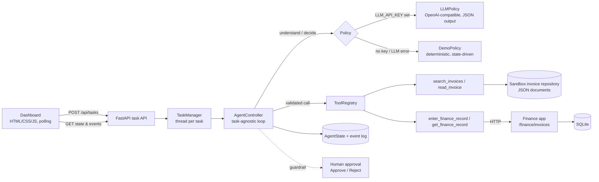

# CentrAlign AI — Autonomous Company Task Worker

> An AI employee should not merely answer *"what should I do?"*
> It should **actually execute the work, observe outcomes, adapt to failures, verify the result, and provide evidence.**

This prototype is a small, genuinely working version of that idea. Give it a natural-language business task; it plans, calls real tools against a sandboxed company environment (a document repository and an internal finance app backed by SQLite), recovers when a system rejects its input, pauses for a human when policy requires it, and only reports success after independently verifying the result.

---

## Problem

Most "AI agents" stop at a plan, or execute a fixed script and report success when the last call returns 200. Real company work is messier: systems reject inputs, data has to be transformed, some actions need sign-off, and "the API said OK" is not proof the work is correct.

## Solution

A task-agnostic **agent controller** that runs an observation-driven loop over a **registry of typed tools**:

- The policy (an LLM, or a deterministic demo policy) chooses **one** next action at a time from the **structured execution state** – never a pre-baked sequence.
- Every tool result becomes an **observation** that feeds the next decision.
- The **runtime** – not the model – enforces the guarantees that matter: only registered tools, schema-validated arguments, bounded retries, human approval above a threshold, and **no "complete" without verified evidence**.

## Demo

Primary task:

```
Find the latest invoice from Acme Corp, extract the invoice number, amount and due date, enter it into the internal finance system, verify it was saved correctly, and tell me when it is done.
```

What happens (real calls, real database):

| # | Agent decides | Observation |
|---|---|---|
| 1 | `search_invoices(company="Acme Corp")` | 2 invoices; newest is INV-2026-104 (01 Oct 2026) |
| 2 | `read_invoice("acme_invoice_oct_2026")` | amount `"₹48,500"`, due `2026-10-15` |
| 3 | `enter_finance_record(amount="₹48,500", …)` | **HTTP 400 – "Amount must be numeric" / hint: remove currency symbols and separators** |
| 4 | *analyses failure* → `enter_finance_record(amount=48500, …)` | HTTP 201 – record **#1842** created (**RECOVERED**) |
| 5 | `get_finance_record(1842)` | runtime compares stored record vs source → **4/4 fields match** (**VERIFIED**) |
| 6 | `complete` | accepted only because verification passed |

Also try from the dashboard:

- **"Find the latest invoice from Globex and add it to finance."** – ₹75,000 exceeds the ₹50,000 threshold, so the runtime pauses with *"Human approval required: invoice amount is ₹75,000. Submit this record?"* and **[Approve] [Reject]**. Nothing is written until a human approves.
- **"…from Umbrella Corp…"** – no such vendor; the agent fails honestly instead of inventing data.
- **Run the Acme task twice** – the finance system returns *409 duplicate*; the agent adapts by retrieving and verifying the existing record instead of creating a second one.

## Architecture



```
app/
├── main.py                 FastAPI app: task API, finance app, dashboard
├── config.py               env-driven settings (.env supported)
├── agent/
│   ├── controller.py       the loop + runtime guarantees (approval, retries, verification gate)
│   ├── planner.py          LLMPolicy + DemoPolicy (same interface)
│   ├── prompts.py          system prompts for structured JSON decisions
│   ├── state.py            AgentState, AgentAction, Observation, Event (Pydantic)
│   └── manager.py          task lifecycle, threads, approval channel
├── tools/
│   ├── registry.py         ToolSpec / ToolRegistry (typed args, hooks)
│   ├── files.py            invoice repository: search_invoices, read_invoice
│   ├── finance.py          enter_finance_record, get_finance_record, verification, approval check
│   └── __init__.py         build_registry() – the only wiring point
├── finance_app/            sandbox "internal finance system" (SQLite + HTTP API)
├── models/schemas.py       public API request/response models
├── sandbox/data/invoices/  fictional invoices
└── static/                 dashboard (index.html, app.js, style.css)
tests/                      17 tests (tools, finance API, agent loop, approval, LLM path)
run.py                      start script
```

## Agent Execution Loop

```
Goal → Understand → Plan → Execute → Observe → Adapt → Verify → Complete
```

1. **Goal** – the raw request is stored as `original_goal`.
2. **Understand** – the policy returns `interpreted_goal`, entities (e.g. company) and success criteria.
3. **Plan** – a structured plan (`[{description, tool}]`). It is a *guide*, shown in the UI and ticked off as steps succeed – it is **not** executed as a script.
4. **Decide** – each turn the policy sees the current state (discovered information, approval status, verification result, last observations) and returns exactly one action:
   ```json
   {"action": "search_invoices", "arguments": {"company": "Acme Corp", "query": "latest invoice"},
    "reason": "Searching for the most recent invoice matching Acme Corp."}
   ```
5. **Execute** – the controller validates the action against the registry and the tool's Pydantic schema, checks guardrails, and runs it.
6. **Observe** – the tool result is recorded as an `Observation`, tool hooks update `discovered_information`, and an event is emitted.
7. **Adapt** – if the last observation failed, the next decision is logged as *"Agent analyzed failure"* and the retry is marked **RECOVERED** when it succeeds.
8. **Verify** – reading a record back triggers an independent field-by-field comparison with the source document.
9. **Complete** – accepted only when `verification_result.verified == true`.

The state tracked per task: `original_goal, interpreted_goal, plan, current_step, completed_steps, observations, discovered_information, tool_results, errors, retry_count, approval_required, approval_status, verification_result, evidence, final_result` (see `app/agent/state.py`).

## Tools

| Tool | What it really does |
|---|---|
| `search_invoices {company, query}` | Scans the sandbox repository, fuzzy-matches vendor, returns structured results newest-first |
| `read_invoice {invoice_id}` | Opens the document (path-traversal safe) and extracts invoice number, company, amount, dates, line items |
| `enter_finance_record {invoice_number, company, amount, due_date, …}` | `POST /finance/invoices` over HTTP to the finance app; returns the system's real status/error/hint |
| `get_finance_record {record_id \| invoice_number}` | `GET /finance/invoices/{id}`; triggers verification against the source |
| `request_human_approval {reason}` | Built-in controller action; pauses the task until Approve/Reject |
| `complete {summary}` / `fail {summary}` | Terminal actions; `complete` is gated on verification |

**Validation failure (requirement "simulate_validation_failure")** is implemented as genuine behaviour of the finance system rather than a separate tool: `POST /finance/invoices` rejects any currency-formatted amount (`"₹48,500"`) with `400 {"success": false, "error": "Amount must be numeric", "hint": "Remove currency symbols and separators"}`. It is deterministic and happens every time a formatted amount is submitted – the agent has no special knowledge of it until it observes the error. (`FINANCE_STRICT_VALIDATION=false` turns it off.)

## Failure Recovery

- Tool errors are returned as structured observations (`error`, `hint`, `http_status`), never swallowed.
- The policy must change its arguments based on the observation; the prompt forbids repeating an identical failing call.
- Retries are bounded (`MAX_TOOL_RETRIES`, default 3 consecutive failures) – then the task fails and escalates.
- Duplicate records (409) are handled by verifying the existing record instead of creating another.
- Tool crashes become observations, controller crashes mark the task `FAILED` (never stuck in `RUNNING`).
- If the LLM call fails or returns invalid JSON, that step falls back to the deterministic policy and a **Model fallback** event is logged.

## Verification

Success is never inferred from a 2xx response. After saving, the agent retrieves the stored record; the runtime compares **invoice_number, company, amount (normalised), due_date** against the source invoice and stores:

```json
{
  "verified": true,
  "evidence": {
    "finance_record_id": 1842,
    "invoice_number": "INV-2026-104",
    "company": "Acme Corp",
    "amount": 48500,
    "due_date": "2026-10-15",
    "source_document": "acme_invoice_oct_2026",
    "comparison": [{"field": "amount", "source": "₹48,500", "stored": 48500, "match": true}, "…"]
  }
}
```

If the model tries to `complete` without this, the controller blocks it with *"Completion blocked: result not verified"* and feeds that back as an observation.

## Human-in-the-loop

`enter_finance_record` declares an `approval_check`: amounts above `APPROVAL_THRESHOLD` (default ₹50,000) require sign-off. This is enforced by the **runtime** before the tool executes, so a model that "forgets" to ask cannot bypass it. The task status becomes `WAITING_FOR_APPROVAL`, the dashboard shows **Approve / Reject**, and execution resumes (or stops without writing anything) on the human's decision. The model can also call `request_human_approval` proactively.

## Security

- The model can only select **registered tools**; unknown actions are rejected and logged. No shell, no `eval`, no arbitrary Python.
- Arguments are validated against Pydantic schemas before execution.
- File access is confined to the sandbox invoice folder (ID whitelist + resolved-path check).
- All data is fictional; no real credentials, no third-party accounts. The LLM key is read from the environment only.
- Reasoning shown in the UI is a concise, user-facing `reason` per action – not private chain-of-thought.

## Setup

Requires Python 3.11+.

```bash
python -m venv .venv
source .venv/bin/activate          # Windows: .venv\Scripts\activate
pip install -r requirements.txt
cp .env.example .env               # optional – add LLM_API_KEY to use a real model
```

## Running

```bash
python run.py
```

Open **http://localhost:8000**. Run the tests with `python -m pytest -q`.

> **Demo mode uses deterministic decisions for reproducibility when an LLM API key is unavailable. Tool execution, failure recovery and verification remain real.**

With `LLM_API_KEY` set, the same controller uses an OpenAI-compatible model (`LLM_MODEL`, `LLM_BASE_URL`). The engine can also be chosen per task from the dashboard (Auto / Demo / LLM).

## Demo Task

```
Find the latest invoice from Acme Corp, extract the invoice number, amount and due date, enter it into the internal finance system, verify it was saved correctly, and tell me when it is done.
```

Use **Reset finance sandbox** on the dashboard to start from an empty finance system before recording.

## Example Execution

Real event log from a run (`GET /api/tasks/{id}/events`, abbreviated):

```
SUCCESS    Goal received
SUCCESS    Goal understood            Locate the most recent invoice from Acme Corp, …
SUCCESS    Plan created               5-step plan; each next action is decided from live observations.
SUCCESS    Searching invoice repository   Found 2 invoice(s) for Acme Corp; latest is INV-2026-104 (issued 2026-10-01)
SUCCESS    Reading invoice            Extracted INV-2026-104: amount ₹48,500, due 2026-10-15
FAILED     Submitting record to finance system — rejected   HTTP 400: Amount must be numeric
SUCCESS    Agent analyzed failure     Finance system rejected the currency-formatted amount ('₹48,500'). Retrying with normalized numeric value 48500.
RECOVERED  Retrying: Submitting record to finance system   Finance record #1842 created (HTTP 201)
SUCCESS    Retrieving finance record for verification      Retrieved record #1842: INV-2026-104, amount 48500, due 2026-10-15
VERIFIED   Verification completed     All 4 fields match between source invoice and finance record #1842
VERIFIED   Task completed             Finance record #1842 for INV-2026-104 (Acme Corp) verified against the source invoice.
```

## API

| Method | Path | Purpose |
|---|---|---|
| POST | `/api/tasks` `{goal, mode?}` | start a task (`mode`: auto / demo / llm) |
| GET | `/api/tasks/{id}` | full state + events |
| GET | `/api/tasks/{id}/events?since=N` | event log (incremental) |
| POST | `/api/tasks/{id}/approve` `{approved, note}` | approve or reject a pending action |
| POST | `/finance/invoices` · GET `/finance/invoices` · GET `/finance/invoices/{id}` | sandbox finance system |
| POST | `/api/sandbox/reset` | clear finance records |

Interactive docs at `/docs`.

## Technical Decisions

- **Own controller instead of LangGraph/CrewAI** – the loop is ~300 lines and every guarantee (approval, retry budget, verification gate) is explicit and testable. A framework would hide exactly the parts being evaluated.
- **Structured state, not a transcript** – the policy decides from `AgentState`, which makes decisions reproducible, inspectable in the UI, and cheap in tokens (the LLM sees a compact state view + last 6 observations).
- **One action per turn** – forces the observe→decide cycle; there is no way to "plan and pretend".
- **Tool registry with typed schemas and hooks** – the controller knows nothing about invoices. Domain logic (what to remember, how to verify, when approval is needed) lives with the tools, so adding a new workflow means registering tools, not editing the loop.
- **Guarantees in the runtime, judgement in the policy** – the model decides *what* to do; the runtime decides what is *allowed* (approval, retries, completion). Safety does not depend on prompt compliance.
- **Finance app over HTTP** – the agent integrates with it the way it would with a real internal service (status codes, error bodies), rather than calling a Python function.
- **SQLite** – real persistence and constraints (unique invoice per vendor) with zero setup.
- **Deterministic demo policy behind the same interface** – reliable demos and CI without an API key; it derives each decision from state and observations (it only normalises the amount after the 400, only re-reads a record after a 409), and is also the fallback when the LLM fails.
- **Polling, not WebSockets** – simplest reliable live updates; 500 ms is plenty for a human-paced timeline.
- **Thread per task** – lets a task block on human approval without blocking the API.

## Limitations

- The demo policy is rule-based and specific to document→system-of-record workflows; generalisation to genuinely new task types needs the LLM policy (or new rules).
- The LLM path is covered by tests against a mocked OpenAI-compatible endpoint; behaviour with a specific real model has not been benchmarked in this build.
- Tasks live in memory; restarting the server loses task history (finance records persist in SQLite).
- Single process; no auth on the API; approval is not tied to user identities.
- Invoices are clean JSON documents; there is no PDF/OCR extraction or browser automation (Playwright was deliberately left out to keep the core loop reliable within the time box).
- Verification compares four key fields only.

## Future Improvements

- **Persistent company memory** – vendor aliases, past corrections ("this system needs plain numbers") reused across tasks.
- **Permissions** – per-tool, per-role scopes and approval policies.
- **Background workers & task queues** – durable execution (e.g. a queue + worker pool) with resumable state.
- **Browser / computer-use tools** – operate legacy web UIs that have no API.
- **Stronger evaluation** – scenario suites with injected faults, success-rate and cost tracking per model.
- **Multi-tenant architecture** – isolated sandboxes, data and tool catalogs per company.
- **Audit logs** – immutable, signed event log for compliance.
- **Production authentication** – SSO for users, secret management for tool credentials.
- **Model fallback** – chains of models (cheap → strong) beyond today's deterministic fallback.
- **Human escalation** – route stuck tasks to the right owner with full context.

## AI Tool Disclosure

AI coding tools were used during development of this prototype, consistent with the challenge instructions. The architecture, behaviour and tests were reviewed and run end-to-end.
